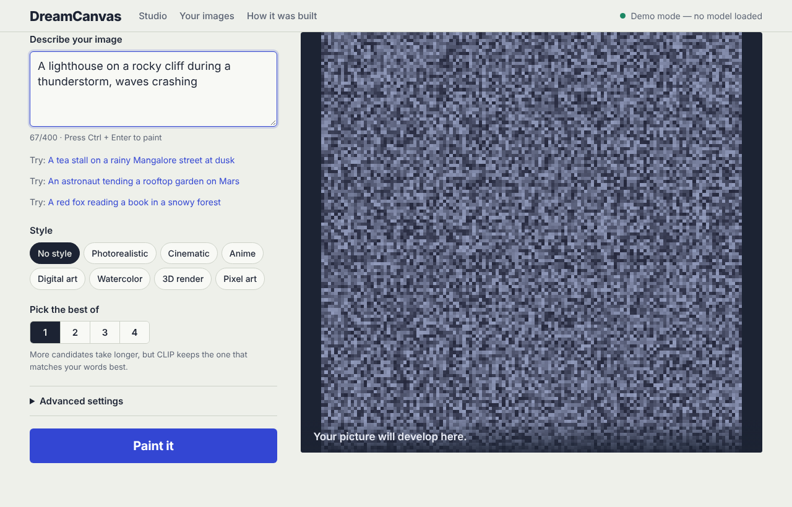

# DreamCanvas

**Describe a picture in words, and DreamCanvas paints it.**

DreamCanvas is a text-to-image website built on Stable Diffusion. You type a description, pick a style, and the model turns random noise into an image that matches your words. It then uses CLIP to score how closely each image fits your description, and shows the best one first.

It runs on a free Google Colab GPU and gives you a public link, so anyone can use it from a browser or phone.



---

## Features

| Feature | What it does |
|---|---|
| **Text to image** | Turns a written description into a 512×512 image (up to 768×768) with Stable Diffusion 1.5. |
| **Style presets** | Eight one-click styles: Photorealistic, Cinematic, Anime, Digital art, Watercolor, 3D render, Pixel art, or none. |
| **Match score** | CLIP compares your words with the finished image and gives a score. Higher means a closer match. |
| **Best-of-N** | Generates 2–4 candidates and keeps the one with the highest match score. You can still view the others. |
| **Leave out** | A negative prompt for things you don't want in the picture, like "people", "blur" or "text". |
| **Reproducible seeds** | Every image shows its seed. The same prompt and seed always give the same picture. |
| **Long-prompt warning** | The model only reads about the first 75 word-pieces. The site warns you while you type and shows exactly which words were ignored. |
| **Gallery** | Your recent images are kept in your browser. Click one to load its prompt and seed again. |
| **Safety checker** | The model's built-in safety checker stays on, and flagged images are blacked out. |
| **Fast mode** | SD-Turbo makes an image in 1–4 steps, which is useful on CPU or for live demos. |
| **Demo mode** | Runs the website with placeholder images and no AI libraries, for working on the design. |

---

## How it works

```
 Your prompt ──► Style preset ──► Stable Diffusion 1.5 ──► CLIP scoring ──► Safety check ──► Best image
                 (adds wording     (removes noise step      (compares words   (flags unsafe
                  and a list of     by step, ~25 steps)      with the image)   images)
                  things to avoid)
```

1. **Prompt building.** The chosen style's key words go at the *start* of the prompt so they're never cut off. Quality words go at the end, and a list of common flaws to avoid (blur, low resolution, watermarks) is added as a negative prompt.
2. **Generation.** Stable Diffusion 1.5 runs in half precision (fp16) with attention slicing and VAE tiling, so it fits comfortably on a free 16 GB T4 GPU. The DPM++ (Karras) scheduler reaches good quality in about 25 steps instead of 50.
3. **Scoring.** CLIP (`openai/clip-vit-base-patch32`) turns the prompt and each image into vectors. The match score is their cosine similarity × 100.
4. **Selection.** With Best-of-N, each candidate gets the next seed (seed, seed+1, …), and the highest-scoring one is shown first.

### Reading the match score

| Score | Meaning |
|---|---|
| 32 and up | Strong match |
| 27 – 32 | Good match |
| 22 – 27 | Partial match. Try more specific wording. |
| below 22 | Weak match. Rephrase or try another seed. |

---

## Running it

### Option 1: Google Colab (recommended, free GPU)

1. Open `run_on_colab.ipynb` in [Google Colab](https://colab.research.google.com).
2. Go to **Runtime → Change runtime type → T4 GPU → Save**.
3. Run the cells in order. Upload `dreamcanvas.zip` when asked.
4. Re-run the status cell until it shows `'status': 'ready'`. The first run downloads about 4 GB of model weights, which takes 3–5 minutes.
5. Open the `trycloudflare.com` link printed by the tunnel cell and share it.

If there's no GPU available, the notebook switches to the faster SD-Turbo model by itself.

### Option 2: Your own computer

Requires Python 3.10+. An NVIDIA GPU with 6 GB+ of memory is strongly recommended.

```bash
pip install -r requirements.txt
python app.py
```

Open **http://localhost:7860**.

| Command | Use it for |
|---|---|
| `python app.py` | Best quality (Stable Diffusion 1.5) |
| `GENAI_MODEL=turbo python app.py` | Fast images in 1–4 steps (SD-Turbo) |
| `GENAI_DEMO=1 python app.py` | Website only, with placeholder images and no AI libraries (needs only `flask` and `pillow`) |
| `PORT=8000 python app.py` | Run on a different port |

On Windows (PowerShell), set variables like this: `$env:GENAI_MODEL="turbo"; python app.py`.

### Typical speed

| Hardware | SD 1.5, 25 steps | SD-Turbo, 2 steps |
|---|---|---|
| Colab T4 GPU | ~5–8 s | ~1 s |
| CPU only | 1–3 min | ~15–30 s |

---

## Tips for better images

- **Put the important things first.** The model reads only about the first 50–60 words.
- **Be concrete.** "A red fox reading a book in a snowy pine forest at dusk" works better than "a cute animal in winter".
- **Match the style to your words.** Don't say "photograph" and then pick Anime, because the two pull in opposite directions.
- **Use "Leave out"** for things that keep showing up but you don't want.
- **Found one you like?** Click **Reuse seed** and change a few words to make variations of it.
- **Known limit:** Stable Diffusion 1.5 can't spell. Words on signs or objects usually come out as squiggles.

---

## Project structure

```
genai-studio/
├── app.py               Flask web server and API
├── engine.py            Stable Diffusion + CLIP engine, style presets, demo engine
├── requirements.txt     Python libraries
├── run_on_colab.ipynb   One-click Colab launcher with a public link
└── static/
    ├── index.html       The website
    ├── style.css        Styling (responsive down to phones)
    ├── app.js           Studio logic, candidates, gallery
    └── samples/         Example images shown on the site
```

---

## API

The website talks to the server through a small JSON API, which you can also call yourself.

### `GET /api/health`
Model status and limits.
```json
{ "status": "ready", "device": "cuda", "model": "Stable Diffusion 1.5",
  "default_steps": 25, "max_steps": 50, "supports_negative": true, "demo": false }
```
`status` is `loading`, `ready` or `error`.

### `GET /api/styles`
The list of style presets: `[{ "key": "photo", "label": "Photorealistic" }, …]`

### `POST /api/generate`
```json
{
  "prompt": "A lighthouse on a rocky cliff during a thunderstorm",
  "negative_prompt": "people",
  "style": "cinematic",
  "candidates": 3,
  "width": 512, "height": 512,
  "steps": 25, "guidance": 7.5,
  "seed": 42
}
```
Only `prompt` is required. The response looks like this:
```json
{
  "images": [ { "png_b64": "...", "seed": 42, "clip_score": 31.4, "flagged": false }, … ],
  "best_index": 0,
  "final_prompt": "cinematic film still, A lighthouse on …",
  "final_negative": "people, flat lighting, …",
  "ignored_text": "",
  "elapsed": 17.2,
  "model": "Stable Diffusion 1.5"
}
```

**Limits:**
- Prompts can be up to 400 characters.
- `candidates` is 1–4.
- Sizes must be one of 256, 384, 512, 576, 640, 704 or 768.
- `steps` is capped per model.
- `guidance` is 0–20.

**Errors:** these return `{ "error": "..." }` with status 400 (bad input), 503 (model still loading) or 500 (for example, GPU out of memory).

---

## Troubleshooting

| Problem | Fix |
|---|---|
| Status says `device: cpu` on Colab | Set **Runtime → T4 GPU**, then run all cells again from the top. |
| "Address already in use" | An old server is still running. The notebook stops it automatically, or you can run `!pkill -f "python app.py"`. |
| Blank box when previewing inside Colab | Your browser is blocking Colab's frame. Use the public trycloudflare link instead. |
| trycloudflare link won't open | Wait 30 seconds and refresh. Some college or office Wi-Fi blocks it, so try mobile data. |
| "GPU ran out of memory" | Use a smaller size or fewer candidates. |
| Style seems ignored | The prompt was probably too long. Check the yellow note under the image. |

---

## Tech stack

- **Model:** Stable Diffusion 1.5 (`stable-diffusion-v1-5/stable-diffusion-v1-5`) and SD-Turbo (`stabilityai/sd-turbo`)
- **Scoring:** CLIP ViT-B/32
- **Libraries:** PyTorch, Hugging Face Diffusers and Transformers
- **Server:** Flask
- **Frontend:** plain HTML, CSS and JavaScript, with no build step
- **Hosting:** Google Colab + Cloudflare quick tunnel

---
